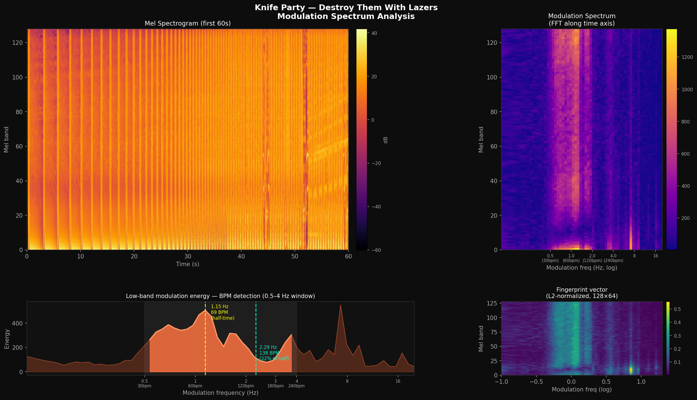

# P.I.R.A.T.E.

**Perceptual Invariant Rhythmic Audio Taxonomy Engine**

A local-first music fingerprinting and similarity engine. Shazam meets iTunes Genius, running entirely on your own library. No cloud, no subscriptions, no streaming service deciding what you like.

## What it does

- **Identify** — "what song is this?" against your own library, robust to clips, re-encodes, and length differences
- **Similar** — "play me something like this" via perceptual fingerprint similarity
- **Playlist** — smart M3U playlists built from seed songs, by sound rather than metadata tags
- **Cluster** — group the whole library by how it actually sounds (K-means or HDBSCAN)
- **Web UI** — browser-based library explorer with search, per-song similarity, and a built-in player

## How it works

Standard spectrograms break when songs have different lengths or BPM. PIRATE uses a **modulation spectrum**: an FFT along the time axis of each mel frequency band. This converts "energy at frequency F at time T" into "energy at frequency F that oscillates at rate R" — a fixed-size representation of a song's rhythmic texture, independent of its length.

```
Audio → Mel Spectrogram → FFT per band along time axis → Modulation Spectrum
        (128 mel bands)    (0.1–20 Hz, log-spaced)       (128 × 64 fingerprint)
```



Similarity search is two-pass (since `8193be3`):

1. **Fast pass** — cosine similarity on one averaged fingerprint per song → top-100 candidates
2. **Accurate pass** — each song also stores up to 8 chunk fingerprints (one per 48 s window). Candidates are re-ranked by **bidirectional median chunk similarity**: `min(median_fwd, median_bwd)`, so a single lucky chunk pair can't dominate and both songs have to recognize each other.

The averaged-fingerprint shortcut is what previously made long tracks (DJ mixes, medleys) score as false near-dupes against everything; the chunk re-rank fixes that. BPM estimation falls out of the same pipeline: the dominant peak in low-band modulation energy (0.5–4 Hz window) is the beat rate.

Audio decoding is delegated to ffmpeg; the mel/modulation pipeline itself is pure numpy/scipy.

## Installation

Requires **Python 3.10+** and **[ffmpeg](https://ffmpeg.org/download.html)** in your PATH. Install from source:

```bash
git clone https://github.com/dudebot/pirate
cd pirate
pip install -e ".[all]"
```

(Or use `pipx install --editable ".[all]"` for an isolated install.)

Extras, if you want to pick à la carte instead of `[all]`:

| Extra | Adds |
|-------|------|
| `[ui]` | FastAPI + uvicorn for `pirate ui` |
| `[auto-cluster]` | hdbscan for `pirate cluster --auto` |

### ffmpeg

| Platform | Install |
|----------|---------|
| macOS | `brew install ffmpeg` |
| Windows | `scoop install ffmpeg` or [download from ffmpeg.org](https://ffmpeg.org/download.html) |
| Ubuntu/Debian | `sudo apt install ffmpeg` |

## Getting started

### 1. Scan your library

```bash
pirate scan ~/Music
```

First run takes a while — a few seconds per track, parallelized across all CPU cores (`-j N` to override). Re-runs with `--update` skip unchanged files:

```bash
pirate scan ~/Music --update
```

### 2. Find similar songs

```bash
# By artist/title search
pirate similar "Daft Punk"

# By file path
pirate similar "/path/to/song.mp3"

# More results
pirate similar "Boards of Canada" -k 20

# Include DJ mixes and long tracks (>20 min are excluded by default)
pirate similar "Aphex Twin" --mixes
```

### 3. Identify a recording

Works like Shazam against your own library. Feed it a clip, a recording, or a full file:

```bash
pirate identify mystery_clip.mp3
pirate identify recording.wav -k 10
```

### 4. Generate a playlist

```bash
# 60-minute playlist seeded from one track
pirate playlist --like "Knife Party" --length 60m --output mix.m3u

# Multiple seeds, steer away from something, custom length
pirate playlist --like "Deadmau5" --like "Daft Punk" --unlike "Some Ballad" --length 1h30m -o mix.m3u
```

The output is a standard M3U file compatible with VLC, foobar2000, mpv, and most players.

### 5. Cluster your library

```bash
# K-means into N clusters (fast, deterministic)
pirate cluster --count 20

# Auto-detect cluster count with HDBSCAN (requires the [auto-cluster] extra)
pirate cluster --auto

# Export cluster assignments as JSON
pirate cluster --count 20 --export clusters.json
```

### 6. Web UI

```bash
pirate ui
```

Opens http://localhost:6272 (change with `--port`, suppress the auto-opened browser with `--no-open`): a sortable, searchable library table with per-song similar-tracks panel, cluster labels, and a built-in audio player with seeking.

### 7. Other commands

```bash
# Show BPM estimate for a track
pirate bpm "Knife Party"

# Library stats
pirate stats
```

Every command accepts `--db PATH` to point at an alternate database.

## Storage

Fingerprints live in `~/.pirate/library.db` (SQLite). A 10,000 song library takes roughly 10 MB, plus chunk fingerprints.

Set `PIRATE_DATA_DIR` to use a different location:

```bash
export PIRATE_DATA_DIR=/external/drive/.pirate
pirate scan /external/drive/Music
```

## Status

Experimental personal project, v0.1. The core pipeline (scan → similar/identify/playlist/cluster) and the web UI work and are in real use on a real library; expect rough edges and no stability guarantees on the fingerprint format (a pipeline version bump triggers re-extraction on the next `--update` scan).
